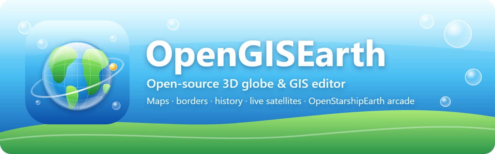

# OpenGISEarth

Open-source 3D globe and GIS editor, designed as an alternative to the Google Earth Pro desktop app.

**Use it in the browser:** https://opengisearth.com · **Play OpenStarshipEarth:** https://opengisearth.com/starship/ · **Windows app:** [Releases](https://github.com/avlopezparra/opengisearth/releases/latest)

- Globe with 3D terrain, open base maps, clouds, international borders, disputed boundaries, regional boundaries, streets, parks and 3D buildings.
- Country, province/region and historical-country layers, each with optional area coloring; historical maps by year.
- Placemarks, paths, polygons and image overlays; editing with snapping and topology.
- Opens and saves KML, KMZ, GeoJSON, Shapefile, GeoPackage, SVG, GPX and CSV.
- More than 100 geoprocessing tools equivalent to those in QGIS and ArcGIS: see [TOOLS.md](TOOLS.md).
- Watersheds by clicking a point, mountain ranges, graticule.
- Print layout (PDF, PNG, SVG) and flight simulator.
- Live satellites, country cards with Wikidata and World Bank data, points of view for disputed territories.

- OpenStarshipEarth: an arcade flight game over the real Earth (adventure, city races, bosses, local and online multiplayer).
- Interface in Spanish and English.

The web app lives in `web/`; `src-tauri/` packages it as a Windows program (Tauri). Design notes: [DESIGN.md](DESIGN.md).

Created by Alejandro Víctor López Parra ([avlopezparra](https://github.com/avlopezparra)). Donations: [PayPal](https://paypal.me/alopcl).
